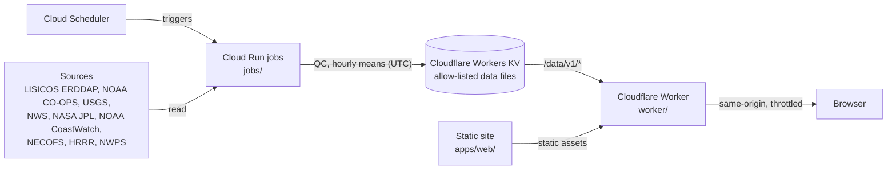

# lhzn-blue

Public marine measurements at [longhorizon.blue](https://longhorizon.blue), curated locally, starting with the
[Long Island Sound](https://longhorizon.blue/long-island-sound/). Each page shows the latest marine conditions from buoys and shore stations, compared with the last few days/weeks/months, and the difference between this year and past years. The recency and provenance of each measurement is tracked and reported. Forecasts are displayed along with their predictive performance in the past and typical error bounds in the future.

- **Data.** The moored buoys of [LISICOS](https://lisicos.uconn.edu/) (Department of Marine Sciences, University of
  Connecticut); NOAA CO-OPS shore stations and tide predictions; USGS stream and
  tidal gauges; NWS airport weather (ASOS); satellite fields from NASA JPL MUR and NOAA CoastWatch; and model output
  from NECOFS (FVCOM), NOAA HRRR and the NWS Nearshore Wave Prediction System. The
  [NERACOOS Mariners' Dashboard](https://mariners.neracoos.org/) covers the wider region. 

- **Status: alpha.** Views, wording and thresholds may change.
- **Not for navigation.** All data and forecasts are generated by upstream sources. Observations frequently become stale and are prone to measurement error. Forecasts are subject to revision and are labeled as model output. Values are shown at the source's resolution or as labelled hourly means; any smoothing or interpolation is stated on the chart.

## How it works



| Job | Schedule | What it refreshes |
| :--- | :--- | :--- |
| `live` | hourly | buoys, shore stations, rivers, airports, USGS tidal gauges, advisories in force |
| `latest` | every 15 minutes | the buoys' water and weather |
| `forecast` | hourly | HRRR at the stations and on its grid, NWPS waves, the models compared, the current phase, charted rips |
| `panels` | every 10 minutes | a transcribed record from the LISICOS station panels during data-server outages |
| `history` | daily | the full buoy records, weather, wave and turbidity history, forecast verification, shore and river history, tides, the advisory record |
| `fields` | daily | satellite fields and their 90-day history, NECOFS surface currents |
| `snapshot` | three times a week | saved copies of the source datasets |

| Page | Contents |
| :--- | :--- |
| `/` | landing |
| `/long-island-sound/` | the waterway page |
| `/long-island-sound/forecast/` | forecast verification |
| `/long-island-sound/models/` | wind models compared |
| `/long-island-sound/tides/` | reading the tides |
| `/about/`, `/references/`, `/terms/` | method and limitations, the sources cited, terms of use |
| `/data/v1/*` | the pages' data files (same-origin, throttled) |

Source types on a waterway page:

- **Moored buoys:** water temperature, salinity, dissolved oxygen and turbidity by depth, with wind, air
  temperature, pressure and waves where published.
- **Shore and tidal stations:** water temperature, weather, water level and tide predictions.
- **River gauges:** discharge against normal for the date.
- **Airport weather stations:** wind on the shore.
- **Satellite fields and model output:** sea surface temperature, chlorophyll-a, water clarity, surface currents,
  wind and waves.

The registries in `stations/` list the stations each page uses.

Views: water temperature, salinity, dissolved oxygen, wind and waves, turbidity, rivers and tides. The map carries
the satellite fields with 90 days of history, the NECOFS surface currents, HRRR wind, NWPS waves and a small-craft
comfort index. One timeline below the map sets the time for the map layers, the charts, the overview table and the
pins.

Readings pass gross-range, spike and placeholder checks before hourly averaging. A dataset the server stops
publishing is retried every hour, and the daily build keeps every hour it already holds. Saved copies of the source
datasets protect the record against withdrawn or renamed datasets.

The browser computes the 36-hour means, the 7-day change, the year-over-year comparison, the seasonal percentiles
and the surface-minus-bottom difference from the hourly series. The charts and the AI prompt share that one
implementation. Each chart opens in a zoom view with tooltips, and the (i) beside it states what it shows, how it is
computed and its sources.

**Collect.** The "+" beside each plot, readout row and the map adds it to a tray. From the tray a visitor can ask
their own AI about the collected items (one image, plus a prompt with the same numbers as text and the method notes)
or email a suggestion.

There is no public data API. The data files serve this site's pages, are throttled per client, and may change
without notice. The underlying observations are available from the sources directly, starting with the
[LISICOS ERDDAP server](http://merlin.dms.uconn.edu:8080/erddap/).

| Path | Contents |
| :--- | :--- |
| `stations/` | Registries shared by the jobs and the pages: buoys, shore stations, rivers, USGS tidal gauges, airports |
| `jobs/` | Python ingest (`lhzn-blue-jobs`): one command per scheduled job, plus one-time imports and backfills |
| `apps/web/` | Vite and TypeScript site |
| `worker/` | Cloudflare Worker: static assets and the allow-listed `/data/v1/*` files from Workers KV |
| `configs/prompts/` | The prompt template behind "Ask your AI" |
| `scripts/` | Setup and deploy scripts; their settings live in `~/.config/lhzn-blue/env`, outside the repository |
| `docs/` | `references.bib` (the References page) and the [roadmap](docs/planning/roadmap.md) |

## Development

```bash
cd jobs && uv sync && uv run lhzn-blue-jobs history --out ../out && uv run lhzn-blue-jobs live --out ../out
uv run lhzn-blue-jobs fields --out ../out                # optional: the map layers
cd ../apps/web && npm ci && npm run dev                  # serves /data/v1/* from ../../out
```

## License

Code: MIT (see `LICENSE`). Data: passed on with credit under each source's terms. Every series names its source
dataset in the data files and on the page.
